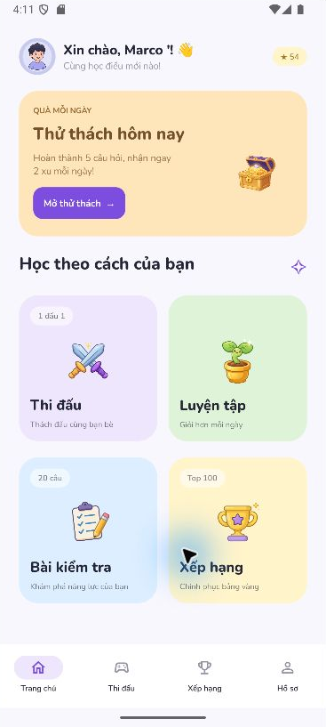
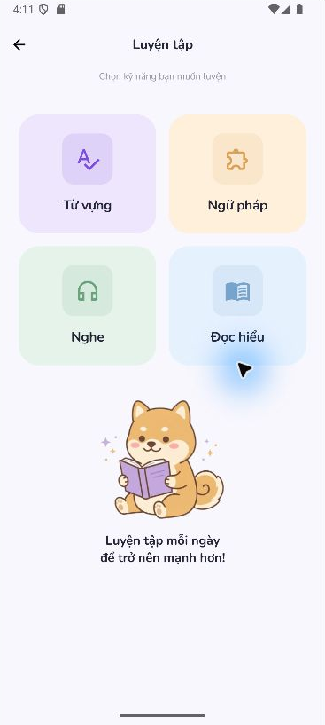
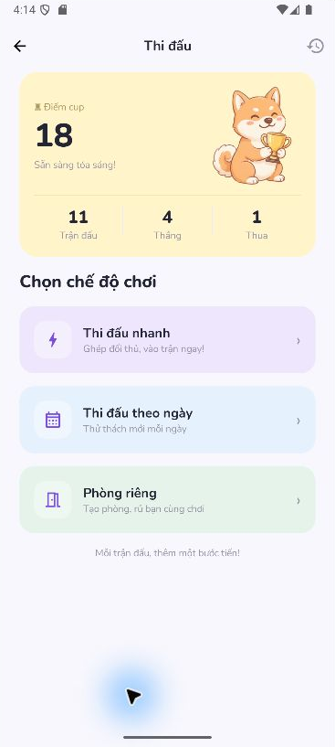
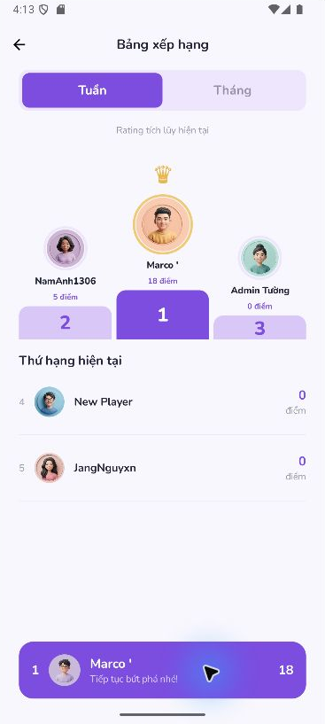
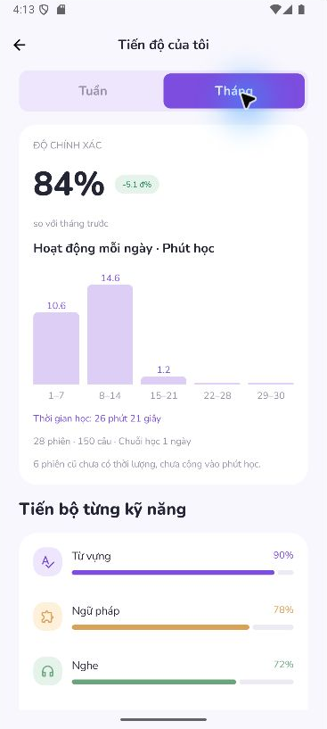
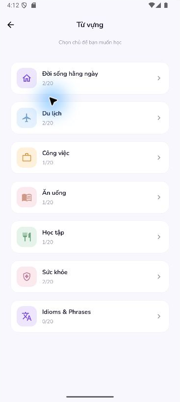
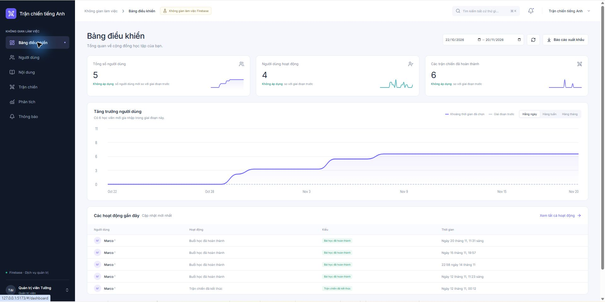
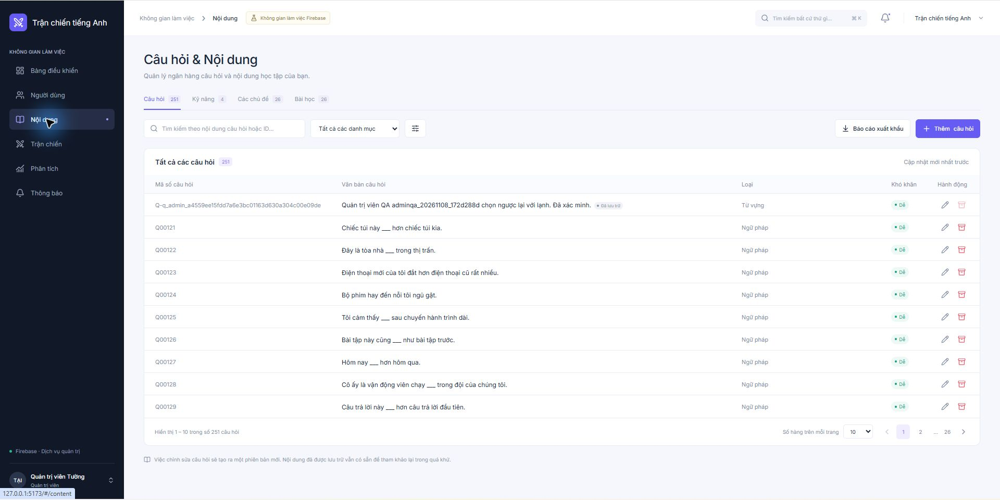
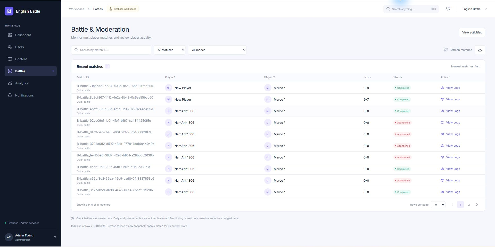

# 🏆 English Battle

### Ứng dụng học tiếng Anh kết hợp thi đấu trực tuyến

Luyện tập bốn kỹ năng, làm bài kiểm tra, tham gia thử thách hằng ngày và theo dõi kết quả trong cùng một tài khoản.

[Giới thiệu](#giới-thiệu) · [Tính năng](#tính-năng) · [Giao diện](#giao-diện) · [Cài đặt](#cài-đặt-và-chạy-dự-án) · [Nhóm phát triển](#nhóm-phát-triển)

---

## Giới thiệu

**English Battle** là đồ án môn **Lập trình thiết bị di động** của nhóm sinh viên Viện Công nghệ thông tin, Trường Đại học Giao thông vận tải TP. Hồ Chí Minh.

Dự án gồm ứng dụng Android cho người học, backend xử lý nghiệp vụ và trang web quản trị. Người học có thể làm bài, xem lại lỗi sai, theo dõi tiến độ và tham gia thi đấu nhanh. Điểm số, thời hạn và phần thưởng do server kiểm tra hoặc quyết định.

| Thông tin | Nội dung |
| --- | --- |
| Môn học | Lập trình thiết bị di động |
| Mã học phần | 012012103402 |
| Giảng viên hướng dẫn | ThS. Trương Quang Tuấn |
| Nền tảng người học | Android |
| Nền tảng quản trị | Web |
| Kho mã nguồn | [EnglishBattle_App-Mobile](https://github.com/HoangGiang-LA/EnglishBattle_App-Mobile) |

> Phạm vi chức năng và kết quả QA trong bản tài liệu này dựa trên báo cáo được đối chiếu đến ngày **20/11/2026**. Các kết quả kiểm thử được giữ cùng ngày và môi trường ghi nhận.

## Tính năng

### Ứng dụng Android

| Nhóm chức năng | Nội dung |
| --- | --- |
| Tài khoản | Đăng nhập email hoặc Google, đồng bộ hồ sơ và phiên xác thực |
| Luyện tập | Từ vựng, ngữ pháp, nghe và đọc hiểu theo chủ đề |
| Kiểm tra | Bài tổng hợp, chấm điểm và trả kết quả |
| Thử thách hằng ngày | Phiên học theo ngày và quy tắc phần thưởng |
| Thi đấu nhanh | Tìm đối thủ, ghép trận, trả lời và xem kết quả |
| Lịch sử | Xem lại bài làm, đáp án, lời giải và kết quả thi đấu |
| Tiến độ | Thống kê theo kỹ năng, tuần/tháng và thời lượng có dữ liệu |
| Bảng xếp hạng | Rating tích lũy, thứ hạng cá nhân và danh sách theo trang |
| Ví xu và thành tích | Số dư, lịch sử giao dịch, điều kiện mở khóa và thông báo trong ứng dụng |

### Web quản trị

| Phân hệ | Chức năng |
| --- | --- |
| Dashboard | Tổng quan hoạt động và các chỉ số theo bộ lọc |
| Users | Tìm kiếm, theo dõi và quản lý quyền truy cập tài khoản |
| Content | Quản lý kỹ năng, chủ đề, bài học, câu hỏi và phiên bản nội dung |
| Battles | Giám sát trạng thái và nhật ký trận đấu |
| Analytics | Tổng hợp hoạt động, kỹ năng, độ chính xác và tình trạng dữ liệu |

API kiểm tra quyền quản trị trước các thao tác. Màn giám sát trận phục vụ theo dõi và không cho thay đổi kết quả đã chốt.

### Quy tắc chính

| Chế độ | Số câu |
| --- | ---: |
| Luyện tập | 10 |
| Kiểm tra tổng hợp | 20 |
| Thử thách hằng ngày | 5 |
| Thi đấu nhanh | 10 |

- Mỗi câu có tối đa **30 giây**, theo thời gian server.
- Hai người trong một trận nhận cùng bộ câu hỏi và thứ tự phương án.
- Phiên làm bài giữ nội dung và phiên bản câu hỏi đã chọn.
- Xu và rating được cập nhật từ kết quả hợp lệ, có cơ chế tránh ghi lặp.
- Bảng xếp hạng tuần/tháng hiện dùng **rating tích lũy**, không đặt lại điểm theo kỳ.
- Phần nghe sử dụng **TTS**. Phiên bản được mô tả chưa chấm phát âm.

Bộ dữ liệu khởi tạo được kiểm tra có **4 kỹ năng, 25 chủ đề, 25 bài học và 250 câu hỏi**. Số bản ghi trên trang quản trị có thể khác do tồn tại nội dung QA, bản nháp hoặc nội dung đã lưu trữ.

## Giao diện

Các ảnh dưới đây được chụp từ ứng dụng và trang quản trị ngày **20/11/2026**.

### Ứng dụng người học

<table>
  <tr>
    <th>Trang chủ</th>
    <th>Luyện tập</th>
    <th>Sảnh thi đấu</th>
  </tr>
  <tr>
    <td align="center"></td>
    <td align="center"></td>
    <td align="center"></td>
  </tr>
  <tr>
    <th>Bảng xếp hạng</th>
    <th>Tiến độ</th>
    <th>Chủ đề từ vựng</th>
  </tr>
  <tr>
    <td align="center"></td>
    <td align="center"></td>
    <td align="center"></td>
  </tr>
</table>

### Trang quản trị

Xem giao diện quản lý nội dung và giám sát trận

**Ngân hàng câu hỏi và nội dung**

**Danh sách trận đấu**

### Thiết kế tham khảo

[Thiết kế giao diện English Battle trên Figma](https://www.figma.com/design/KH2g6ct0xPjDKMkR2SzKLk/App-English-Battle?node-id=122-2)

Thiết kế được điều chỉnh theo phạm vi sản phẩm: bỏ XP/level, sử dụng rating tích lũy và tách các chức năng còn phát triển khỏi chức năng đã có backend.

## Công nghệ sử dụng

| Thành phần | Công nghệ |
| --- | --- |
| Android | Kotlin, Jetpack Compose, ViewModel, Repository, Credential Manager |
| Backend | Node.js, TypeScript, Firebase Admin SDK |
| Xác thực | Firebase Authentication |
| Cơ sở dữ liệu | Firebase Realtime Database |
| Web quản trị | React, TypeScript, Vite |
| Kết nối API | HTTPS, HTTP adapter theo định dạng callable, Cloudflare Tunnel |
| Kiểm thử | Firebase Emulator Suite, kiểm thử HTTP, Vitest, Testing Library, Playwright và các bộ Android |
| Quản lý mã nguồn | Git và GitHub |

## Kiến trúc và vận hành

~~~mermaid
flowchart TB
    App["Ứng dụng Android"] --> Tunnel["Cloudflare Tunnel"]
    Tunnel --> API["HTTP API người học"]
    App --> Auth["Firebase Authentication"]
    API --> Auth
    API --> DB["Realtime Database"]
    Worker["Worker"] --> DB
    Admin["Web quản trị"] --> AdminAPI["API quản trị"]
    AdminAPI --> DB
~~~

- **Android** hiển thị trạng thái và gửi thao tác của người học.
- **HTTP API** xác minh token, kiểm tra đầu vào và gọi các hàm nghiệp vụ.
- **Worker** xử lý deadline, ghép trận và tiếp tục các bước kết quả/phần thưởng còn thiếu.
- **Firebase Auth và RTDB** quản lý danh tính, dữ liệu tài khoản và dữ liệu hoạt động.
- **Cloudflare Tunnel** chuyển tiếp yêu cầu HTTPS tới API trên máy chủ cá nhân.

Trong mô hình được báo cáo, các handler callable được tái sử dụng qua HTTP API. API và worker chạy trên máy chủ cá nhân; Functions Emulator phục vụ phát triển cục bộ. Máy chủ, worker và kết nối Internet cần được duy trì khi người dùng truy cập dịch vụ.

### Những điểm kỹ thuật chính

- Thời hạn câu hỏi do server quyết định.
- Snapshot và phiên bản câu hỏi giữ ổn định nội dung bài đang làm.
- Transaction xử lý các quyết định có tranh chấp.
- `requestId`, mã khoản thưởng và dấu đã áp dụng hỗ trợ gửi lại an toàn.
- Lease và hàng đợi giúp worker nhận lại công việc bị gián đoạn.
- API và Security Rules giới hạn quyền truy cập theo tài khoản.
- Thống kê ghi rõ dữ liệu thiếu thay vì tự gán thời lượng.

## Cấu trúc mã nguồn

| Đường dẫn | Vai trò |
| --- | --- |
| `frontend/app/` | Ứng dụng Android |
| `frontend/admin-web/` | Web quản trị |
| `Backend/functions/src/be1/` | Nghiệp vụ phía người học |
| `Backend/functions/src/admin/` | Nghiệp vụ quản trị |
| `Backend/functions/tools/mobile-api/` | HTTP adapter cho Android |
| `Backend/functions/tools/learning-worker.mjs` | Worker và xử lý nền |
| `Backend/database/` | Seed, mô tả và tài liệu dữ liệu |
| `Backend/tests/` | Kiểm thử tích hợp và biên bản nghiệm thu |

## Cài đặt và chạy dự án

### 1. Chuẩn bị môi trường

- Git.
- Android Studio cùng Android SDK phù hợp cấu hình dự án.
- JDK và Node.js theo cấu hình trong repository. Báo cáo khảo sát sử dụng **JDK 21** cho Gradle và **Node.js 24** cho backend.
- Quyền truy cập Firebase project của nhóm.
- Cloudflare Tunnel nếu cần sử dụng API từ mạng bên ngoài.

### 2. Lấy mã nguồn

~~~bash
git clone https://github.com/HoangGiang-LA/EnglishBattle_App-Mobile.git
cd EnglishBattle_App-Mobile
~~~

### 3. Thiết lập Firebase

- Sử dụng đúng Firebase project đã thống nhất với nhóm.
- Cấu hình Firebase cho ứng dụng Android và web quản trị.
- Thiết lập cấu hình Admin SDK theo tài liệu backend; báo cáo ghi nhận cấu hình server tại `Backend/server/.env`.
- Đọc hướng dẫn đăng nhập Google trước khi build bản release.
- Giữ khóa Admin SDK, biến môi trường và khóa ký APK ngoài repository.

Tài liệu liên quan: [API Android](Backend/functions/MOBILE-API.md) và [Google Sign-In](frontend/GOOGLE-SIGN-IN.md).

### 4. Chạy backend người học

Cài dependencies:

~~~bash
npm --prefix Backend/functions install
~~~

Khởi động HTTP API và worker:

~~~bash
npm --prefix Backend/functions run start:mobile
~~~

Launcher build TypeScript và khởi động các tiến trình cần thiết. API gốc chỉ lắng nghe loopback.

Kiểm tra trên PowerShell:

~~~powershell
Invoke-RestMethod http://127.0.0.1:8081/health
~~~

Phản hồi health chỉ xác nhận dịch vụ HTTP đang trả lời; các thao tác nghiệp vụ vẫn cần token và dữ liệu hợp lệ.

### 5. Kết nối Android

- Mở project Android trong thư mục `frontend` bằng Android Studio.
- Đồng bộ Gradle và kiểm tra cấu hình Firebase.
- Chọn máy ảo hoặc điện thoại, sau đó chạy ứng dụng.
- Đối chiếu `mobileApiBaseUrl` với mô hình API đang sử dụng.

Theo cấu hình được mô tả trong báo cáo:

| Địa chỉ | Vai trò |
| --- | --- |
| `https://api.twgxeo.win/api` | Base URL nghiệp vụ của Android |
| `http://127.0.0.1:8081` | HTTP API gốc trên máy chủ |
| `10.0.2.2` | Địa chỉ truy cập host khi phát triển bằng Android Emulator |
| Cổng 5001 | Functions Emulator cho phát triển |
| Cổng 8080 | Máy chủ quản trị tài khoản |

APK từ mạng bên ngoài cần gọi hostname HTTPS qua Tunnel. Mô hình này cần máy chủ và Tunnel hoạt động; địa chỉ loopback của máy tính không phải địa chỉ truy cập trực tiếp từ điện thoại bên ngoài.

### 6. Chạy web quản trị

Thiết lập Firebase và API quản trị theo tài liệu của thư mục `frontend/admin-web`. Môi trường phát triển được khảo sát sử dụng Vite tại `http://127.0.0.1:5173/`.

Quản trị viên cần tài khoản được cấp quyền phù hợp. Backend tiếp tục kiểm tra quyền dù giao diện đã hiển thị các nút thao tác.

## Kiểm thử

Các lệnh được ghi trong tài liệu dự án:

~~~bash
npm --prefix Backend/functions run build
npm --prefix Backend/functions run lint
npm --prefix Backend/functions run test:mobile
npm --prefix Backend/functions run test:acceptance -- --mobile
npm --prefix Backend/functions run test:admin:acceptance
~~~

Bộ kiểm thử có fixture, seed hoặc tiêm lỗi cần chạy trong project demo và môi trường emulator theo launcher của từng bộ.

Kết quả QA đã ghi nhận trong báo cáo

| Bộ kiểm thử | Kết quả ghi nhận | Mốc và phạm vi |
| --- | ---: | --- |
| HTTP API Android | 11/11 | 20/11/2026; HTTP loopback và bộ xác minh token giả lập |
| Backend người học | 193/193 | Biên bản 02/11/2026; hồi quy trên emulator |
| Admin integration | 118/118 | Biên bản 08/11/2026; guard, đồng thời và phục hồi |
| Android JVM | 27/27 | Theo các mốc QA trong báo cáo |

Các bộ khác nhau về ngày, mã nguồn và môi trường. Đây là các kết quả đã ghi nhận, không phải trạng thái CI của mọi commit và không được cộng thành một tỷ lệ đạt chung.

## Tài liệu kỹ thuật

| Tài liệu | Nội dung |
| --- | --- |
| [Backend README](Backend/functions/README.md) | Engine học tập, worker và phục hồi |
| [Mobile API](Backend/functions/MOBILE-API.md) | HTTP API Android và Tunnel |
| [Battle](Backend/functions/BATTLE.md) | Thi đấu nhanh, kết nối lại và kết quả |
| [Reporting](Backend/functions/REPORTING.md) | Thống kê, thời lượng và phân trang |
| [Community](Backend/functions/COMMUNITY.md) | Bảng xếp hạng, thành tích và thông báo trong app |
| [Google Sign-In](frontend/GOOGLE-SIGN-IN.md) | Google Auth, chứng chỉ và release |
| [Backend acceptance](Backend/tests/be1/ACCEPTANCE.md) | Nghiệm thu backend phía người học |
| [Admin acceptance](Backend/functions/ADMIN-ACCEPTANCE.md) | Nghiệm thu quản trị |

## Giới hạn hiện tại

- API phụ thuộc máy chủ cá nhân, worker và kết nối Internet.
- Thi đấu theo ngày, phòng riêng, thông báo đẩy FCM và đổi xu chưa hoàn tất trong phạm vi báo cáo.
- Ngân hàng câu hỏi khởi tạo còn giới hạn và cần rà soát chuyên môn.
- Một số dữ liệu lịch sử chưa có đủ timing hoặc thời điểm bắt đầu.
- Cần bổ sung nghiệm thu hai điện thoại thật, đo tải và theo dõi vận hành dài hạn.
- Chưa có nghiên cứu người dùng có đối chứng để kết luận mức cải thiện tiếng Anh.

## Hướng phát triển

- [ ] Nghiệm thu hai thiết bị thật với các tình huống mất mạng và kết nối lại.
- [ ] Đo thời gian phản hồi, tỷ lệ lỗi và tải đồng thời.
- [ ] Bổ sung giám sát và đánh giá phương án vận hành.
- [ ] Mở rộng, rà soát câu hỏi và lời giải.
- [ ] Hoàn thiện các chế độ thi đấu còn thiếu và FCM.
- [ ] Tổ chức thử nghiệm người dùng với mục tiêu và cách đo cụ thể.

## Nhóm phát triển

| Thành viên | MSSV | Phụ trách |
| --- | --- | --- |
| Nguyễn Mạnh Tường | 086205008776 | Frontend Android; backend đăng nhập, thi đấu, thử thách hằng ngày và xếp hạng |
| Nguyễn Hoàng Nam Anh | 033205013140 | Backend và API quản trị: người dùng, nội dung, giám sát trận và thống kê |
| Nguyễn Hoàng Giang | 075205007095 | Backend và API luyện tập, kiểm tra, lịch sử, thông báo, thành tích, xu và tiến độ |

Cả nhóm phối hợp thống nhất hợp đồng dữ liệu, tích hợp chức năng, kiểm thử và hoàn thiện báo cáo.

---

**English Battle**  
Đồ án môn Lập trình thiết bị di động  
Trường Đại học Giao thông vận tải TP. Hồ Chí Minh

